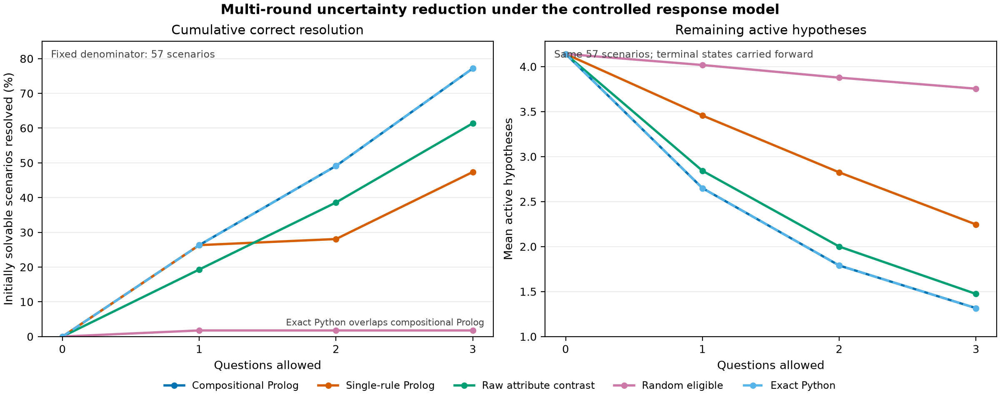
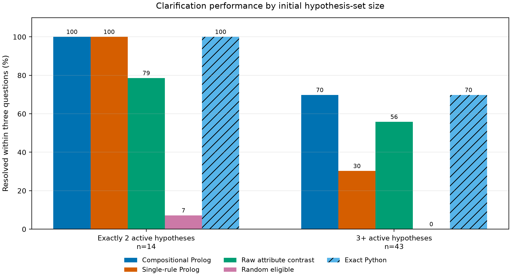
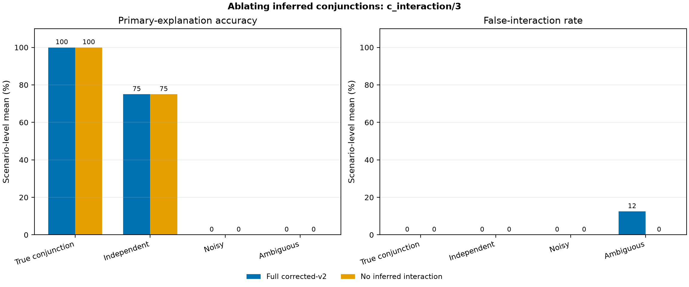
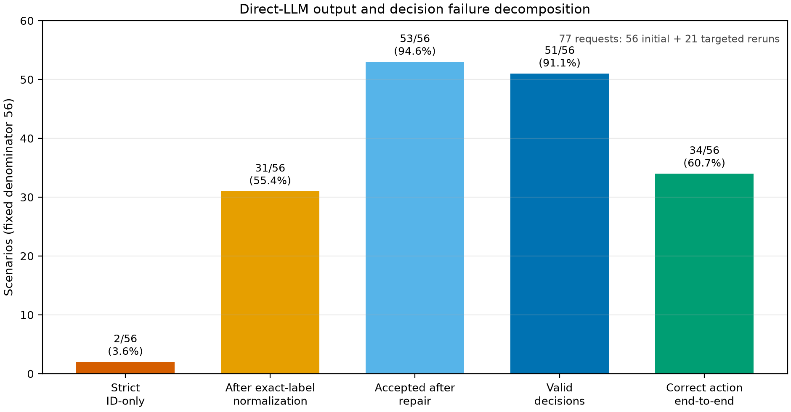

# Experimental Depth and Ablation Report

## Research questions and hypotheses

This study extends the existing controlled evaluation of the Logic-Driven
Museum Tour Guide. It asks: (RQ1) why compositional clarification outperforms
simpler selectors; (RQ2) when its extra complexity helps or fails; and (RQ3)
what incremental value is caused specifically by the inferred-conjunction rule
`c_interaction/3`. Two secondary analyses separate direct-LLM formatting from
reasoning errors and separate clarification timing from question quality.

The preregistered directional hypotheses were that the full active-hypothesis
objective would reduce uncertainty faster, that its advantage would concentrate
in states with three or more hypotheses, and that inferred conjunctions would
improve true-conjunction accuracy while risking false interactions under
ambiguity. The third hypothesis is not supported by the available benchmark:
its true-conjunction cases are explicit, so they do not exercise the ablated
inference rule.

## Experimental conditions and validity controls

### Multi-round clarification

All five methods use the same 65 Phase 1.1 scenarios, candidate pools, replayed
observations, three-question limit, and declared positive-support response
model. The 57 initially solvable scenarios form the fixed denominator for
cumulative resolution and carried-forward hypothesis-set size.

- **Compositional Prolog** maximizes distinguished pairs over the complete
  active hypothesis set and returns a proof.
- **Single-rule Prolog** selects from only the first competing hypothesis pair.
- **Raw attribute contrast** uses independent positive-evidence counts.
- **Random eligible** uses the committed deterministic run.
- **Exact Python** independently optimizes the same formal objective and stable
  tie-break; it is not the production inference engine.

### Interaction ablation

The 32 robustness scenarios contain eight authored categories with four
scenarios each. The full condition is production `corrected_v2`. The ablated
condition loads the same Prolog policy and replaces only `c_interaction/3` with
failure in an evaluation-only wrapper. Imported facts, explicit conjunctions,
atomic evidence, evidence priorities, rankings, decisions, candidate order,
and clarification rules remain unchanged. The 36 authored worlds are averaged
within their 32 scenarios before aggregation. A regression check confirms that
the unabated engine reproduces every committed scenario signature.

### Saved direct-LLM and clarification analyses

No new LLM request was made. Strict, normalized, repaired, and final outcomes
come from the committed 56-scenario direct-LLM artifacts. The clarification
audit uses the existing 32 robustness scenarios. These tasks are distinct from
Phase 1.1 pairwise artwork selection.

No resampling was needed. Seed `32631202` remains reserved for future
resampling or sensitivity checks; the historical random-selector artifact
retains its recorded seed `3263`.

## Results

### RQ1 — multi-round uncertainty reduction

| Method | Resolved after rounds 0 / 1 / 2 / 3 (fixed n=57) | Mean active hypotheses after rounds 0 / 1 / 2 / 3 | Mean hypotheses eliminated per selected question |
|---|---:|---:|---:|
| Compositional Prolog | 0 / 15 / 28 / 44 | 4.140 / 2.649 / 1.789 / 1.316 | 1.258 |
| Single-rule Prolog | 0 / 15 / 16 / 27 | 4.140 / 3.456 / 2.825 / 2.246 | 0.771 |
| Raw attribute contrast | 0 / 11 / 22 / 35 | 4.140 / 2.842 / 2.000 / 1.474 | 1.101 |
| Random eligible | 0 / 1 / 1 / 1 | 4.140 / 4.018 / 3.877 / 3.754 | 0.126 |
| Exact Python | 0 / 15 / 28 / 44 | 4.140 / 2.649 / 1.789 / 1.316 | 1.258 |

Compositional Prolog finishes at 44/57 (77.19%), compared with 27/57
(47.37%) for single-rule Prolog and 35/57 (61.40%) for raw contrast. Its
single-rule advantage is 17 scenarios or 29.82 percentage points. The methods
tie after one question, then diverge because the compositional objective
continues to account for all remaining pairwise conflicts. Exact Python
overlaps it throughout, showing that the measured gain comes from the objective
rather than from Prolog as a numerical optimizer. Prolog's contribution is the
executable rule policy and auditable proof, not faster optimization.



### RQ2 — dependence on scenario difficulty

| Initial active hypotheses | n | Compositional | Single-rule | Raw contrast | Random | Exact Python |
|---|---:|---:|---:|---:|---:|---:|
| Exactly 2 | 14 | 14/14 (100%) | 14/14 (100%) | 11/14 (78.57%) | 1/14 (7.14%) | 14/14 (100%) |
| 3 or more | 43 | 30/43 (69.77%) | 13/43 (30.23%) | 24/43 (55.81%) | 0/43 (0%) | 30/43 (69.77%) |

There is no compositional advantage over single-rule Prolog when exactly two
hypotheses are active. With three or more, the advantage is 39.53 percentage
points. On this harder stratum compositional questions distinguish 2.360 pairs
on average, versus 1.421 for single-rule, and require 2.50 questions per
successful resolution versus 2.77. This improvement costs selector time:
883.1 ms versus 644.9 ms per attempt in the saved run. Paired scenario outcomes
show 18 compositional-only successes, one single-rule-only success, 12 shared
successes, and 12 shared failures.



`controlled_multi_16` is a representative compositional success: considering
all active conflicts resolves the controlled hidden hypothesis in two
questions, whereas single-rule remains unresolved after three. The opposite
case `phase_1_1_multi_021` is important: the aggregate optimum receives
responses that preserve two hypotheses, while the single-rule trajectory
happens to resolve its hidden hypothesis. Maximizing aggregate distinction does
not guarantee the best question for every possible hidden state.

### RQ3 — controlled ablation of `c_interaction/3`

| Condition (32 scenario units; 36 worlds averaged within units) | Primary accuracy | Explanation precision / recall | False interaction | False atomic interest | Action accuracy | Top-1 relevance | Clarification precision / recall |
|---|---:|---:|---:|---:|---:|---:|---:|
| Full corrected-v2 | 59.38% | 62.76% / 84.38% | 1.56% | 34.38% | 96.88% | 82.81% | 100% / 100% |
| No inferred interaction | 59.38% | 62.50% / 82.81% | 0% | 34.38% | 96.88% | 81.25% | 100% / 100% |

The ablation changes the explanation set in only 1/32 scenarios,
`ambiguous_albert`. It changes no primary explanation, action type, or selected
recommendation, but changes one clarification question: the full policy asks
about an Expressionist-style-and-portrait conjunction, whereas the ablation
asks about Expressionism movement. Removing the inference eliminates the
ambiguous category's 12.5% false-interaction rate but reduces its explanation
recall from 100% to 87.5% and top-1 relevance from 87.5% to 75% under its
within-scenario two-world average.

All four true-conjunction scenarios score identically because their conjunction
is explicitly confirmed. This proves the ablation preserves explicit
conjunction representation, but it also means the benchmark cannot measure
whether `c_interaction/3` discovers latent true conjunctions. Independent,
noisy, contradictory, missing-evidence, correction, and true-atomic cases are
unchanged. The appropriate conclusion is limited: the rule affects which
ambiguity is clarified, not aggregate action accuracy on this benchmark.



### Direct-LLM failure decomposition

| Stage | Result |
|---|---:|
| Strict ID-only validity | 2/56 (3.57%) |
| Valid after deterministic exact-label normalization | 31/56 (55.36%) |
| Accepted after conservative repair / targeted rerun | 53/56 (94.64%) |
| Deterministically valid decisions after repair | 51/56 (91.07%) |
| Correct action among accepted outputs | 34/53 (64.15%) |
| Correct action among valid decisions | 32/51 (62.75%) |
| End-to-end correct action | 34/56 (60.71%) |
| Requests across both passes | 77 (56 initial + 21 reruns) |

Before reruns, the 25 invalid outputs comprised 16 semantic or structural
contract failures, four conservative syntax/schema aliases, three provider
failures, and two unrecoverable malformed-JSON cases. Three outputs remained
invalid: an inactive primary explanation, invalid output fields, and trailing
extra JSON data. Two more accepted outputs violated deterministic decision
validity. Among valid decisions, 19 action-type errors remained: 13 missed
clarifications (`clarify→recommend`), two unnecessary clarifications
(`recommend→clarify`), and four failures to abstain appropriately
(`insufficient_evidence→clarify`). Formatting repair therefore does not remove
the main reasoning-policy errors. The second chance is not an equal-budget
comparison with single-shot Prolog.



### Clarification timing versus question quality

On the 32 robustness scenarios, Prolog's authored-label timing confusion matrix
is 9 TP, 0 FP, and 0 FN. The one-pass LLM has 1 TP, 4 FP, and 8 FN (20.0%
precision, 11.11% recall). After repair it has 3 TP, 6 FP, and 6 FN (33.33%
precision and recall).

Conditional on asking, Prolog grounds 9/9 questions and targets a competitive
explanation in 8/9; the repaired LLM grounds 7/9 and targets 6/9. These rates
are selection-biased because every Prolog question is asked in a labelled-needed
case, while six of nine LLM questions are unnecessary. Effective competitive
diagnostic recall over all nine needed scenarios is therefore 8/9 versus 2/9.

The three cases where both ask prevent an overly broad quality claim. Both ask
the same grounded question in `independent_feline_impressionist`; neither asks
a competitive-diagnostic question in `noisy_water`, and the LLM question is
ungrounded; but in `ambiguous_cellist` the LLM's musical-subject question
splits the two authored worlds (1 bit) while Prolog's Expressionist-style
question does not (0 bits). Counterfactual replay uses the same exact oracle and
Prolog updater for both questions. It compares question choice, not independent
multi-turn LLM adaptation.

## Threats to validity

- Controlled responses and authored worlds are not human museum preferences,
  psychological information gain, or evidence of educational benefit.
- The evaluator and symbolic method share declared response semantics; their
  agreement validates implementation of those semantics, not the semantics
  themselves.
- Difficulty strata contain 14 and 43 scenarios and are not population samples.
  Paired differences are descriptive.
- The interaction benchmark has no independently labelled latent-conjunction
  category. Its explicit conjunctions cannot identify the causal benefit of
  inference.
- Saved runtimes are environment- and process-startup-dependent. Exact Python
  is faster because it avoids fresh SWI-Prolog processes and proof construction.
- Repaired LLM outputs use 77 requests, while Prolog is single-pass. The repair
  condition must not be described as equal-budget.
- Question-quality metrics are conditional on asking and therefore affected by
  selection bias. The matched subset contains only three scenarios.
- ArtGraph v1.0's displayed Zenodo licence field was blank during the dataset
  audit. No bulk RDF or images are redistributed.

## Reproduction

```powershell
.\.venv\Scripts\python.exe -m pip install -e ".[dev]"
.\.venv\Scripts\python.exe -m evaluation.depth_analysis.run_all
.\.venv\Scripts\python.exe -m pytest -q tests\test_depth_analysis.py
.\.venv\Scripts\python.exe -m pytest -q
$tests = Get-ChildItem -LiteralPath 'logic\tests' -Filter 'test_*.pl' | Sort-Object Name
foreach ($test in $tests) {
  & .\.tools\swipl\bin\swipl.exe -q -s $test.FullName -g run_tests -t halt
  if ($LASTEXITCODE -ne 0) { exit $LASTEXITCODE }
}
```

Observed verification environment and results:

- Python 3.12.10 and Matplotlib 3.11.2.
- SWI-Prolog 10.0.2 for x64 Windows.
- Dedicated depth-analysis suite: **12 passed**.
- Full Python suite: **144 passed in 46.44 seconds**.
- Six Prolog suites: **42 test declarations passed**.
- Deterministic regeneration: **26 generated CSV, JSON, Markdown, PNG and SVG
  artifacts reproduced byte-for-byte**.
- Full corrected-v2 regression: all 32 robustness scenario signatures matched
  the committed result artifact before the ablation was accepted.

## Prior versus newly generated results

The Phase 1.1 final totals, corrected preference-state outputs, direct-LLM
responses, and clarification audits were already committed. Newly generated in
this study are the fixed-cohort cumulative trajectories, difficulty-stratified
paired comparison, live evaluation-only interaction ablation, unified LLM
failure funnel, timing-versus-quality synthesis, publication figures, and the
report integration plan. Historical datasets, labels, CSVs, JSON results, and
LLM responses were not overwritten.

